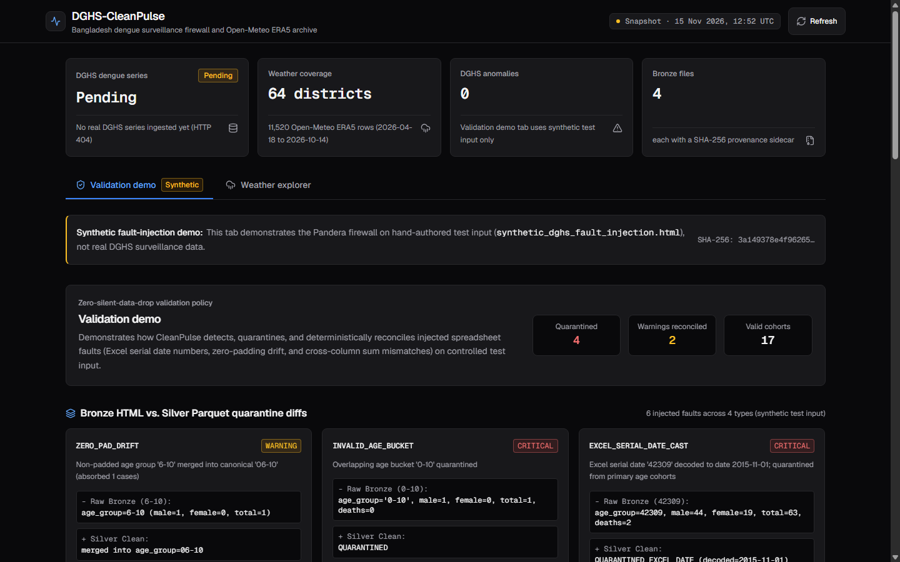
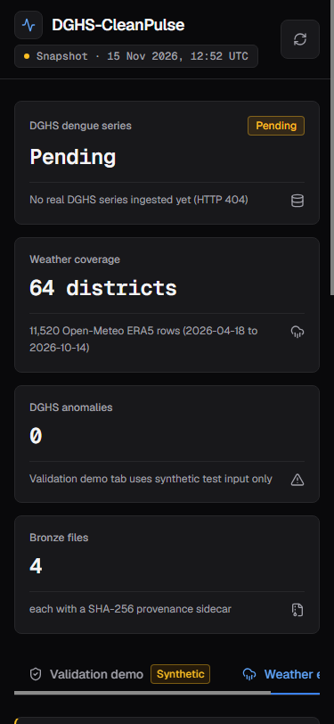

# DGHS-CleanPulse

[](https://github.com/TahmidShafi/dghs-cleanpulse/actions/workflows/ci.yml)

**DGHS-CleanPulse** is a Medallion-architecture data engineering pipeline (Bronze → Silver → Gold), Pandera validation firewall, DuckDB analytics API, and Next.js console for Bangladesh dengue surveillance and district-level climate data.

> **Current status:** While the official DGHS dengue dashboard remains offline (HTTP 404), the repository now ingests **secondary historical dengue surveillance** (2022–2024 daily division-level case counts from Mendeley Dataset A, clearly labelled as a third-party transcription of DGHS daily press releases) paired with **2022–2024 Open-Meteo ERA5 reanalysis** across all 64 districts. Pre-registered weekly descriptive Spearman lag correlations (`lags 0–8`) are computed in the Gold layer and served in Tab 2 (*Historical analysis*), while Tab 1 (*Validation demo*) continues to demonstrate the Pandera validation firewall on synthetic fault-injection input. Live DGHS scraping remains fail-loud until the official feed returns.

---

## Visual Overview

### Validation demo (synthetic input)
*Demonstrates the Pandera validation firewall on the hand-authored `backend/tests/fixtures/synthetic_dghs_fault_injection.html` test input (not real DGHS data).*



### Weather explorer
*Displays the 64-district Open-Meteo Historical Weather API series (`2026-04-18` to `2026-10-14`) with a visible notice that the dengue time series and lag correlation are pending a real DGHS source.*


### Mobile view (Weather explorer at 375px)
*Responsive 375px mobile layout of the Weather explorer tab.*



---

## Pandera Validation Firewall (Synthetic Fault-Injection Oracle)

The Silver firewall (`backend/src/cleanpulse/silver/firewall.py`) enforces a **Zero-Silent-Data-Drop** policy using `pandera.pandas` (`lazy=True`) and records anomalies to `audit_anomalies.parquet`. Because the live DGHS endpoint has not yet been ingested, the firewall is currently tested against a **synthetic fault-injection fixture** (`backend/tests/fixtures/synthetic_dghs_fault_injection.html`) containing deliberately injected faults:
- `EXCEL_SERIAL_DATE_CAST`: Windows 1900 serial date integers (`42309`, `46301`) in age-group labels, decoded and quarantined.
- `ZERO_PAD_DRIFT`: Unnormalized cohort formatting (`6-10` vs `06-10`), canonicalized and merged.
- `GENDER_SUM_MISMATCH`: Arithmetic discrepancy in `21-25`, reconciled with `arithmetic_delta` preserved.
- `INVALID_AGE_BUCKET`: Non-standard (`0-10`) and empty (`""`) cohort labels, quarantined without silent dropping.

---

## Medallion Architecture & Fail-Loud Guarantees

- **`data/bronze/`**: Immutable raw responses (`dghs/YYYY-MM-DD/<UTC>.html` and `weather/YYYY-MM-DD/<UTC>_batch_XX.json`), each paired with a JSON provenance sidecar (`url`, `http_status`, `sha256`, `fetched_at_utc`, `fetch_source`, `git_commit`, `git_dirty`). Existing files are never overwritten.
- **`data/silver/`**: Pandera-validated Parquet tables built strictly from Bronze (`weather_districts_daily.parquet`). Live fetch/parse errors fail loudly with explicit exceptions and non-zero CLI exit codes—no silent fallbacks.
- **`data/gold/`**: DuckDB spatiotemporal lag engine (`backend/src/cleanpulse/gold/lag_engine.py`), currently exercised only in unit tests on in-test synthetic inputs until a real dengue series exists.
- **`frontend/public/data/`**:
  - `fallback_snapshot.json`: Generated from real `data/` tables via `backend/scripts/export_frontend_snapshot.py`, including `generated_at_utc` and `git_commit` metadata.
  - `demo_synthetic_fault_injection.json`: Generated from the synthetic fixture for Tab 1's labelled demo.

---

## Running Locally

### Weather-Only Pipeline (works while DGHS is 404)
```bash
uv sync --project backend --extra dev --locked
uv run --project backend python -m cleanpulse.cli ingest-weather
uv run --project backend python -m cleanpulse.cli build-silver --weather-only
uv run --project backend python backend/scripts/export_frontend_snapshot.py
```

### API & Dashboard
```bash
# FastAPI + DuckDB analytics API
uv run --project backend uvicorn cleanpulse.api.main:app --reload --port 8000

# Next.js dashboard
npm --prefix frontend run dev

# Full stack via Docker Compose
docker compose up --build
```

#### API Endpoints (`backend/src/cleanpulse/api/main.py`)
- `GET /v1/surveillance/summary` — Live DGHS status (`pending_real_source` while offline) plus secondary `historical` 2022–2024 summary metadata.
- `GET /v1/historical/weekly?scope=<National|division>` — 156 ISO-week rows (`2022-W01` to `2024-W52`) joining secondary division/national dengue cases with Open-Meteo ERA5 weekly aggregates.
- `GET /v1/analytics/lag-correlations?scope=<scope>&variable=<var>` — Descriptive weekly Spearman `rho` across lags `0–8` weeks (`raw` and `diff_log` transforms, with sample size `n`, no p-values).
- `GET /v1/surveillance/lags` — Legacy live-DGHS lag endpoint (`pending_real_source` until live DGHS data is ingested).
- `GET /v1/weather/daily` — 64-district daily Open-Meteo ERA5 weather series.
- `GET /v1/audit/anomalies` — Pandera validation anomalies log.
- `GET /v1/health/pipeline` — DuckDB table availability, Silver/Gold row counts, and provenance metadata.

### Quality Gates
```bash
uv run --project backend ruff check backend/
uv run --project backend ruff format --check backend/
uv run --project backend mypy backend/src
uv run --project backend pytest backend/tests/ -v
npm --prefix frontend run lint
npm --prefix frontend run build
```

Verify weather row count and date range directly from the Silver Parquet table:
```bash
uv run --project backend python -c "import pandas as pd; df = pd.read_parquet('data/silver/weather_districts_daily.parquet'); print(len(df), df['district_id'].nunique(), df['date'].min(), df['date'].max())"
```

---

## Data Sources & Limitations

1. **Primary Historical Dengue Series — Secondary Source (Mendeley Dataset A, 2022–2024):**
   - **Citation & Licence:** Naher (Mendeley Data, DOI [`10.17632/z5mvwrfgsz.1`](https://doi.org/10.17632/z5mvwrfgsz.1), [CC BY 4.0](https://creativecommons.org/licenses/by/4.0/)).
   - **Provenance & Caveat:** Labelled everywhere in this repository as *"secondary source: transcribed from DGHS daily press releases (unverified transcription by third party)"*. Only the daily division-level case counts are ingested; the dataset's bundled weather columns are dropped.
   - **Transformations Applied:** Report dates are shifted `-1 day` (because DGHS daily press releases cover the 24 hours ending 08:00 Asia/Dhaka on the report date) and aggregated to ISO 8601 Monday–Sunday weeks (`2022-W01` to `2024-W52`; incomplete edge weeks dropped and logged).
2. **Reconciliation-Only Source (Mendeley Dataset B, 2020–2025):**
   - **Citation & Licence:** Hasan, Ifti & Ifty (Mendeley Data, DOI [`10.17632/cgwjshkx5k.2`](https://doi.org/10.17632/cgwjshkx5k.2), [CC BY 4.0](https://creativecommons.org/licenses/by/4.0/)).
   - **Scope:** Monthly division-level cases and deaths used strictly for cross-source reconciliation against Dataset A and official DGHS published annual totals ([`data/reference/dghs_published_annual_totals.csv`](data/reference/dghs_published_annual_totals.csv)). Dataset B and its death counts are not served on the dashboard. See [`docs/reconciliation_report.md`](docs/reconciliation_report.md) for full comparison figures.
3. **Weather Data (Open-Meteo Historical Weather API — ERA5 Reanalysis):**
   - Sourced from the [Open-Meteo Historical Weather API](https://open-meteo.com/en/docs/historical-weather-api) ([CC BY 4.0](https://creativecommons.org/licenses/by/4.0/)) with `models=era5`, which serves gridded **ERA5 reanalysis** (~0.25 degree grid) rather than raw point weather-station measurements. District daily values are averaged to division and national weekly series.
   - The active Silver/Gold weather window covers `2022-01-01` to `2024-12-31` across all 64 districts. Earlier 2026 Bronze weather snapshots remain archived in `data/bronze/` with their SHA-256 provenance sidecars.
4. **Descriptive Analysis & Pre-Registration:**
   - The weekly Spearman rank correlation analysis (`lags 0–8`) was pre-registered in [`docs/analysis_plan.md`](docs/analysis_plan.md) before any climate-dengue correlation was computed on real data. Descriptive results (without p-values, due to strong weekly autocorrelation and 486 multiple comparisons) are recorded in [`docs/analysis_results.md`](docs/analysis_results.md).
5. **Live DGHS Surveillance Feed (`https://dashboard.dghs.gov.bd/pages/heoc_dengue_v1.php`):**
   - Returned **HTTP 404 Not Found** when last checked on `2026-11-15` (site root showed a maintenance notice). The live scraper remains fail-loud and unvalidated against the live DGHS HTML structure until the official feed returns.
   - Reporting in [Prothom Alo](https://en.prothomalo.com/amp/story/bangladesh/tarjg9blv4) has also noted discrepancies between DGHS control-room press releases and individual hospital totals.
   - The Docker Compose setup has not been re-tested since the Phase 1/2 changes.
