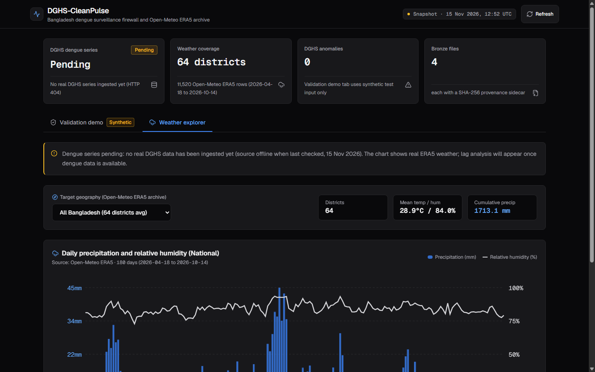

# DGHS-CleanPulse

[](https://github.com/TahmidShafi/dghs-cleanpulse/actions/workflows/ci.yml)

**DGHS-CleanPulse** is a Medallion-architecture data engineering pipeline (Bronze → Silver → Gold), Pandera validation firewall, DuckDB analytics API, and Next.js console for Bangladesh dengue surveillance and district-level climate data.

> **Current status:** No real DGHS dengue data is currently ingested. All synthetic dengue series and silent fallbacks have been removed. The repository currently serves real Open-Meteo ERA5 archive data for 64 districts alongside a clearly labelled synthetic fault-injection demo for the Pandera validation firewall.

---

## Visual Overview

### Tab 1: Validation Demo (Synthetic Fault-Injection Input)
*Demonstrates the Pandera validation firewall on the hand-authored `backend/tests/fixtures/synthetic_dghs_fault_injection.html` test input (not real DGHS data).*


### Tab 2: Real Weather Explorer (Dengue Pending)
*Displays the 64-district Open-Meteo Historical Weather API series (`2026-04-18` to `2026-10-14`) with a visible notice that the dengue time series and lag correlation are pending a real DGHS source.*



---

## Pandera Validation Firewall (Synthetic Fault-Injection Oracle)

The Silver firewall (`backend/src/cleanpulse/silver/firewall.py`) enforces a **Zero-Silent-Data-Drop** policy using `pandera.pandas` (`lazy=True`) and records anomalies to `audit_anomalies.parquet`. Because the live DGHS endpoint has not yet been ingested, the firewall is currently tested against a **synthetic fault-injection fixture** (`backend/tests/fixtures/synthetic_dghs_fault_injection.html`) containing deliberately injected faults:
- `EXCEL_SERIAL_DATE_CAST`: Windows 1900 serial date integers (`42309`, `46301`) in age-group labels, decoded and quarantined.
- `ZERO_PAD_DRIFT`: Unnormalized cohort formatting (`6-10` vs `06-10`), canonicalized and merged.
- `GENDER_SUM_MISMATCH`: Arithmetic discrepancy in `21-25`, reconciled with `arithmetic_delta` preserved.
- `INVALID_AGE_BUCKET`: Non-standard (`0-10`) and empty (`""`) cohort labels, quarantined without silent dropping.

---

## Medallion Architecture & Fail-Loud Guarantees

- **`data/bronze/`**: Immutable raw responses (`dghs/YYYY-MM-DD/<UTC>.html` and `weather/YYYY-MM-DD/<UTC>_batch_XX.json`), each paired with a JSON provenance sidecar (`url`, `http_status`, `sha256`, `fetched_at_utc`, `fetch_source`, `git_commit`, `git_dirty`). Existing files are never overwritten.
- **`data/silver/`**: Pandera-validated Parquet tables built strictly from Bronze (`weather_districts_daily.parquet`). Live fetch/parse errors fail loudly with explicit exceptions and non-zero CLI exit codes—no silent fallbacks.
- **`data/gold/`**: DuckDB spatiotemporal lag engine (`backend/src/cleanpulse/gold/lag_engine.py`), currently exercised only in unit tests on in-test synthetic inputs until a real dengue series exists.
- **`frontend/public/data/`**:
  - `fallback_snapshot.json`: Generated from real `data/` tables via `backend/scripts/export_frontend_snapshot.py`, including `generated_at_utc` and `git_commit` metadata.
  - `demo_synthetic_fault_injection.json`: Generated from the synthetic fixture for Tab 1's labelled demo.

---

## Running Locally

### Weather-Only Pipeline (works while DGHS is 404)
```bash
uv sync --project backend --extra dev --locked
uv run --project backend python -m cleanpulse.cli ingest-weather
uv run --project backend python -m cleanpulse.cli build-silver --weather-only
uv run --project backend python backend/scripts/export_frontend_snapshot.py
```

### API & Dashboard
```bash
# FastAPI + DuckDB analytics API
uv run --project backend uvicorn cleanpulse.api.main:app --reload --port 8000

# Next.js dashboard
npm --prefix frontend run dev

# Full stack via Docker Compose
docker compose up --build
```

#### API Endpoints (`backend/src/cleanpulse/api/main.py`)
- `GET /v1/surveillance/summary` — National and zone-level surveillance KPIs (`pending_real_source` until real DGHS data is ingested).
- `GET /v1/surveillance/lags` — Climate-dengue lag correlations (`pending_real_source` until real DGHS data is ingested).
- `GET /v1/weather/daily` — 64-district daily Open-Meteo ERA5 weather series.
- `GET /v1/audit/anomalies` — Pandera validation anomalies log.
- `GET /v1/health/pipeline` — DuckDB table availability, Silver/Gold row counts, and provenance metadata.

### Quality Gates
```bash
uv run --project backend ruff check backend/
uv run --project backend ruff format --check backend/
uv run --project backend mypy backend/src
uv run --project backend pytest backend/tests/ -v
npm --prefix frontend run lint
npm --prefix frontend run build
```

Verify weather row count and date range directly from the Silver Parquet table:
```bash
uv run --project backend python -c "import pandas as pd; df = pd.read_parquet('data/silver/weather_districts_daily.parquet'); print(len(df), df['district_id'].nunique(), df['date'].min(), df['date'].max())"
```
Output on `2026-11-15`: `11520 64 2026-04-18 2026-10-14`.

---

## Data Sources & Limitations

1. **DGHS Dengue Surveillance (`https://dashboard.dghs.gov.bd/pages/heoc_dengue_v1.php`):**
   - Returned **HTTP 404 Not Found** when checked on `2026-11-15` (the site root showed a maintenance notice).
   - **No real dengue data has been ingested yet.** The HTML parser (`dghs_scraper.py`) was written against a hand-authored synthetic fixture (`synthetic_dghs_fault_injection.html`) and has **never been validated on the real DGHS page**.
   - Additionally, reporting in [Prothom Alo](https://en.prothomalo.com/amp/story/bangladesh/tarjg9blv4) found that the DGHS control room's press release listed fewer dengue admissions at certain hospitals than those hospitals' own figures.
2. **Weather Data (Open-Meteo Historical Weather API):**
   - Sourced from the [Open-Meteo Historical Weather API](https://open-meteo.com/en/docs/historical-weather-api) with `models=era5`, which serves gridded **ERA5 reanalysis** (~0.25 degree grid) model estimates built from observations (stations, aircraft, buoys, radar, satellites) rather than raw point weather-station measurements.
   - Values for the same dates can differ between fetches and between models, so the pipeline pins `models=era5` and archives every raw response with a provenance sidecar.
   - The date range (`2026-04-18` to `2026-10-14`) was inherited from an earlier version and will be aligned with the real DGHS series in Phase 2.
3. **Known Gaps & Phase 2 Roadmap:**
   - Phase 2 will locate and validate the active official DGHS dengue source, adapt the Bronze parser to the real HTML/API/PDF structure, and re-enable Gold spatiotemporal lag analysis on real surveillance data.
   - The Docker Compose setup has not been re-tested since the Phase 1 changes.
